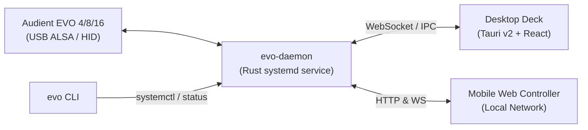

# EVO Linux Control Suite

<p align="center">
  <strong>Native Linux control suite, background daemon, horizontal hardware deck, and zero-install mobile controller for Audient EVO audio interfaces.</strong>
</p>

<p align="center">
  <a href="https://github.com/SebaAguiar/evo-linux-control-suite/actions/workflows/build.yml"></a>
  <a href="LICENSE"></a>
  <a href="https://www.rust-lang.org/"></a>
  <a href="https://tauri.app/"></a>
  <a href="https://conventionalcommits.org"></a>
</p>

---

## Overview

The **EVO Linux Control Suite** fills the gap left by the lack of official Linux software for **Audient EVO** audio interfaces. It delivers full hardware synchronization, bidirectional control between software and hardware knobs, an ultra-low-resource daemon, a horizontal hardware deck desktop app, and an instant mobile remote controller via QR code.

Whether you're tracking vocals across the room, mixing a podcast, or streaming on Linux, EVO Linux Control Suite provides a seamless, zero-friction workflow.

---

## Key Features

- 🎛️ **Horizontal Desktop Deck (`apps/desktop`)**
  - **Hardware-Accurate Form Factor**: Compact 620×360 px horizontal deck styled after physical audio hardware, designed to sit unobtrusively alongside your DAW, OBS, or browser.
  - **3-Wing Ergonomic Layout**:
    - **Left Wing (Inputs)**: Mic/Line 1 & 2 channel selection, gain metering, and one-click `+48V` Phantom Power toggling.
    - **Center Wing (Main Dial)**: Prominent rotary encoder with live LED ring matching the physical EVO dial, drag-to-adjust, and double-click numeric editing.
    - **Right Wing (Outputs & Monitor)**: Speaker and headphone output controls with instant mute.
  - **Bidirectional Hardware Sync**: Twisting the physical dial on your EVO interface updates the desktop deck and mobile web app in real time; adjustments made in the UI immediately light up the physical LED ring on the interface.

- ⚡ **Ultra-Lightweight Background Daemon (`evo-daemon`)**
  - Built with Rust for maximum stability and minimal resource consumption (~3 MB RAM).
  - Runs as an unprivileged `systemd` user service (`evo-daemon.service`).
  - Automatically detects device plugging/unplugging via `udev` and ALSA.
  - Serves WebSocket events for sub-millisecond UI updates and an embedded HTTP server for web control.

- 📱 **Mobile Web Controller & QR Code (`evo qr`)**
  - **Zero Install Needed**: No native app required on your mobile device.
  - Run `evo qr` in your terminal or access it from the desktop app to generate a Wi-Fi QR code.
  - Point your phone's camera at the QR code to open the responsive web controller on your local network. Adjust preamp gains and toggle phantom power directly from your vocal booth or drum kit.

- 💻 **Unified CLI Management (`evo`)**
  - Intuitive commands to control and inspect the system: `evo start`, `evo stop`, `evo restart`, `evo status`, `evo logs`, and `evo qr`.

---

## Hardware Compatibility

| Interface | Status | Capabilities Supported |
|---|---|---|
| **Audient EVO 4** | ✅ **Fully Supported & Verified** | Inputs 1 & 2, +48V Phantom Power, Smartgain, Main Output, Headphone Output, Hardware Dial Bidirectional Sync |
| **Audient EVO 8** | 🔄 **Protocol Ready** | Channels 1–4, Dual Headphone outputs, Phantom Power |
| **Audient EVO 16** | 🔄 **Protocol Ready** | Multi-channel preamps, Optical I/O channel mapping |

---

## Architecture



- **[`crates/evo-protocol`](file:///home/seba/Documentos/trabajo/arsian/evo-linux-control-suite/crates/evo-protocol)**: Vendor-specific USB HID protocol definitions, packet serialization, and packet framing for EVO interfaces.
- **[`crates/evo-daemon`](file:///home/seba/Documentos/trabajo/arsian/evo-linux-control-suite/crates/evo-daemon)**: The core background daemon managing device communication, state synchronization, WebSocket broadcasting, and local HTTP serving.
- **[`apps/desktop`](file:///home/seba/Documentos/trabajo/arsian/evo-linux-control-suite/apps/desktop)**: Native Linux desktop application built with Tauri v2, React, TypeScript, and Tailwind CSS.
- **[`apps/web`](file:///home/seba/Documentos/trabajo/arsian/evo-linux-control-suite/apps/web)**: Touch-friendly mobile web controller bundled into the daemon.
- **[`driver/`](file:///home/seba/Documentos/trabajo/arsian/evo-linux-control-suite/driver)**: System `udev` rules granting unprivileged user access to EVO USB HID endpoints.
- **[`scripts/`](file:///home/seba/Documentos/trabajo/arsian/evo-linux-control-suite/scripts)**: Command-line control script (`evo`) and automated installer (`install.sh`).

---

## Installation

### Prerequisites

You need Rust and basic build dependencies installed on your system.

**Debian / Ubuntu / Pop!_OS:**
```bash
sudo apt update
sudo apt install -y pkg-config libasound2-dev libudev-dev libssl-dev build-essential \
  libgtk-3-dev libwebkit2gtk-4.1-dev libappindicator3-dev librsvg2-dev
```

**Arch Linux / Manjaro:**
```bash
sudo pacman -S --needed base-devel pkgconf alsa-lib systemd openssl gtk3 webkit2gtk-4.1 libappindicator-gtk3 librsvg
```

**Fedora:**
```bash
sudo dnf install -y pkg-config alsa-lib-devel systemd-devel openssl-devel \
  gtk3-devel webkit2gtk4.1-devel libappindicator-gtk3-devel librsvg2-devel
```

### Quick Install (No Git or Rust Required)

You can install the complete precompiled suite (`evo-daemon`, `evo-desktop`, `evo` CLI, udev rules, and systemd service) directly with a single command:

```bash
curl -fsSL https://github.com/SebaAguiar/evo-linux-control-suite/releases/latest/download/install.sh | bash
```

La app de escritorio necesita **WebKitGTK 4.1**, **GTK 3** y **gtk-layer-shell** (para el modo panel) en tiempo de ejecución. Si el instalador detecta que faltan, te ofrece instalarlas; también podés forzarlo sin preguntas:

```bash
curl -fsSL https://github.com/SebaAguiar/evo-linux-control-suite/releases/latest/download/install.sh | bash -s -- --install-deps
```

En Arch/CachyOS el instalador primero verifica si las dependencias ya están presentes (sin tocar el gestor de paquetes), limpia del caché de pacman las descargas falladas que quedaron guardadas como HTML, y si `pacman -S` falla porque la base de datos está atrasada, te ofrece actualizar el sistema con `pacman -Syu` antes de reintentar.

Si preferís que el gestor de paquetes resuelva las dependencias automáticamente, usá el `.deb` en Debian/Ubuntu.

### Build & Install from Source

If you prefer building from source, install the build dependencies above, clone the repository, and run the automated installer:

```bash
git clone https://github.com/SebaAguiar/evo-linux-control-suite.git
cd evo-linux-control-suite
./scripts/install.sh
```

The installer will automatically:
1. Detect precompiled binaries or compile `evo-daemon` and `evo-desktop` (Tauri v2) in release mode.
2. Install the `udev` rules (`70-audient-evo.rules`) and reload `udev` (unprivileged hardware access).
3. Install and enable the `systemd` user service (`evo-daemon.service`).
4. Install the `evo` command to `~/.local/bin/evo` and `evo-desktop` to `~/.local/bin/evo-desktop`.
5. Install desktop application launcher and icons (`evo-control.desktop`).

---

## Usage

### Managing the Daemon via CLI

The `evo` CLI script allows easy management of the background service:

```bash
evo status       # View daemon status, uptime, and connected hardware
evo start        # Start the background daemon
evo stop         # Stop the background daemon
evo restart      # Restart the background daemon
evo logs         # Follow real-time daemon logs (press Ctrl+C to exit)
evo qr           # Print a terminal QR code to connect your phone
```

### Launching the Desktop Deck

Launch the desktop application from your application menu or from the terminal:

```bash
evo-desktop
```

- **Adjust Gain / Volume**: Click and drag the central rotary knob up/down, or double-click the central numeric value to type an exact dB level.
- **Toggle Phantom Power**: Select an input channel and click the `48V` button to safely toggle phantom power.
- **Mute**: Click the `MUTE` button to instantly mute the active channel or output.

### Mobile Web Control

1. Ensure your smartphone or tablet is connected to the same local Wi-Fi network as your Linux PC.
2. Run:
   ```bash
   evo qr
   ```
3. Scan the generated QR code with your mobile camera.
4. Enjoy real-time control from your phone with zero app installation!

---

## Development & Contributing

We welcome contributions! Please review our [Contributing Guide](CONTRIBUTING.md) and [Code of Conduct](CODE_OF_CONDUCT.md) before submitting pull requests.

### Local Development Setup

1. **Clone the repository:**
   ```bash
   git clone https://github.com/SebaAguiar/evo-linux-control-suite.git
   cd evo-linux-control-suite
   ```

2. **Install Node/pnpm tooling & Git hooks:**
   ```bash
   pnpm install
   ```
   *Husky and Commitlint will automatically validate your commits following the [Conventional Commits](https://www.conventionalcommits.org/) specification.*

3. **Check the Rust workspace:**
   ```bash
   cargo check --workspace --exclude evo-desktop
   cargo test --workspace --exclude evo-desktop
   ```

4. **Run Desktop frontend in dev mode:**
   ```bash
   cd apps/desktop
   bun install
   bun run dev
   ```

### Branching Strategy

- **`main`**: Protected production branch. All updates arrive via Pull Requests.
- **`dev`**: Active integration branch for new features and bug fixes.

---

## Security

For security vulnerabilities, please refer to our [Security Policy](SECURITY.md) and submit a private report via [GitHub Security Advisories](https://github.com/SebaAguiar/evo-linux-control-suite/security/advisories/new).

---

## License

This project is open-source software licensed under the [MIT License](LICENSE).
Audient and EVO are trademarks of Audient Limited. This project is an independent community initiative and is not affiliated with or endorsed by Audient.